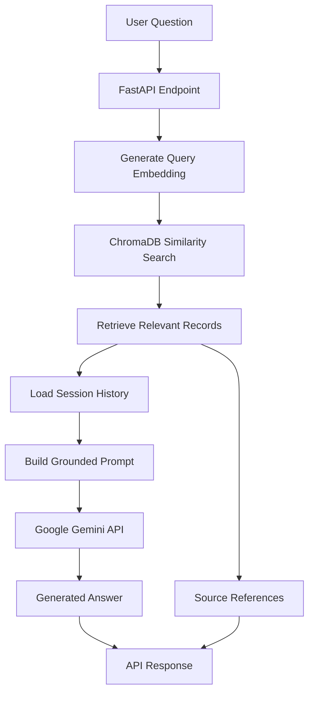

# Harvest-AIsights

**A Retrieval-Augmented Generation (RAG) API for querying agricultural commodity prices.**

AgriQuotes Assistant is a Python-based question-answering system designed to retrieve and explain agricultural commodity quotations from structured market data.

It combines **FastAPI, multilingual embeddings, ChromaDB, and Google Gemini** to retrieve relevant price records and generate answers grounded in the retrieved data.

Instead of relying entirely on an LLM's internal knowledge, the system provides the model with relevant source records and returns those records alongside its response, including their original file and row references.

> **Project status:** Portfolio project in active development. The real Gemini API and production embedding pipeline have not yet been fully validated end to end.
>
> **Disclaimer:** This project is for technical demonstration and informational purposes only. It does not provide financial or investment advice.

---

## Key Features

- **RAG-based question answering:** Retrieves relevant quotation records before generating an answer.
- **Multilingual semantic search:** Uses Sentence Transformers to generate embeddings for questions and data records.
- **Vector database:** Stores and retrieves embeddings using ChromaDB.
- **Source traceability:** Returns the retrieved records, including source file, row number, and relevant text.
- **Conversational sessions:** Maintains a short-term conversation history for each session.
- **Structured data ingestion:** Converts CSV rows into self-contained text records for indexing.
- **Multiple file formats:** Includes generic loaders for CSV, PDF, TXT, and Markdown.
- **Prompt injection mitigation:** Treats retrieved content as untrusted data when constructing prompts.
- **Retrieval evaluation:** Includes Hit@K and Mean Reciprocal Rank (MRR) metrics.
- **Automated testing:** Uses pytest with mocked embedding and LLM components.

## Technology Stack

| Technology | Purpose |
|---|---|
| Python 3.12 | Main development language |
| FastAPI | REST API framework |
| Google Gemini API | LLM response generation |
| Sentence Transformers | Text embeddings |
| multilingual-e5-small | Default embedding model |
| ChromaDB | Vector storage and similarity search |
| Pydantic | Request and response validation |
| Pytest | Automated testing |

## How It Works

The application follows a Retrieval-Augmented Generation pipeline.



### 1. Data ingestion

The ingestion process reads files from the configured data directory and converts their contents into searchable text records.

For the agricultural quotations dataset, each CSV row becomes an independent, self-contained document containing information such as:

- Commodity and product name
- Market and delivery location
- Reference date
- Contract information
- Price and currency unit
- Market variations and other available fields

Each record is then embedded and stored in ChromaDB.

### 2. Semantic retrieval

When a user submits a question:

1. The question is converted into an embedding.
2. ChromaDB searches for the most semantically similar records.
3. The application retrieves the top matching records according to the `TOP_K` configuration.
4. The retrieved records are passed to the language model as contextual evidence.

### 3. Grounded answer generation

Google Gemini receives the user's question, conversation context, and retrieved records.

The prompt instructs the model to answer using the provided evidence rather than introducing unsupported information.

The API returns both the generated answer and the retrieved source records.

---

## Dataset

The repository includes a sample dataset:

`data/agritel_quotes.csv`

The dataset represents a **single reference date: October 30, 2026**. It does not contain historical time-series data.

| Market | Records | Price units |
|---|---:|---|
| Physical | 8 | EUR/tonne |
| Euronext | 23 | EUR/tonne |
| CBOT | 79 | Multiple units |
| Argus | 21 | EUR/tonne and USD/tonne |
| **Total** | **131** | — |

Commodities covered include:

- Wheat and durum wheat
- Corn
- Barley
- Soybeans
- Soybean meal and oil
- Rapeseed and rapeseed oil
- Sunflower
- Peas

### Data processing decisions

Some transformations require explicit assumptions:

- Contract labels such as `26 de dezembro` are interpreted as December 2026 based on the pattern observed in the dataset. This is an inference, not a confirmed interpretation from the original data provider.
- Dates in `DD/MM/YYYY` format are converted to `YYYY-MM-DD`.
- The `-` symbol is treated as a missing value.
- English commodity names are mapped to Portuguese equivalents to support Portuguese-language queries.
- The meaning and unit of the `variation` field are not documented by the dataset, so the application does not assume whether it represents an absolute or percentage change.

---

## Machine Learning Approach

This project integrates pre-trained machine learning models rather than training its own models.

| Component | Approach |
|---|---|
| Embeddings | Pre-trained Sentence Transformers model |
| Default embedding model | `intfloat/multilingual-e5-small` |
| Retrieval | Cosine similarity through ChromaDB |
| Answer generation | Google Gemini API |
| Model training | Not performed |
| Fine-tuning | Not performed |

The embedding model converts questions and quotation records into numerical representations. ChromaDB uses these representations to identify semantically relevant records.

Google Gemini is consumed through its API; no custom LLM is trained or hosted by this project.

---

## Project Structure

```text
.
├── app/
│   ├── main.py
│   ├── dependencies.py
│   ├── ingest.py
│   ├── core/
│   │   ├── config.py
│   │   └── exceptions.py
│   ├── models/
│   │   └── schemas.py
│   ├── routes/
│   │   ├── chat.py
│   │   └── health.py
│   └── services/
│       ├── ingestion.py
│       ├── tabular.py
│       ├── embeddings.py
│       ├── vectorstore.py
│       ├── history.py
│       ├── prompts.py
│       ├── llm.py
│       └── rag.py
├── data/
│   └── agritel_quotes.csv
├── eval/
│   ├── evaluate.py
│   ├── make_questions.py
│   └── questions.jsonl
├── tests/
├── requirements.txt
├── requirements-dev.txt
├── .env.example
└── README.md
```

## Getting Started

### Prerequisites

- Python 3.12
- A Google Gemini API key
- Internet access to download the embedding model on its first execution
- Sufficient disk space for PyTorch and Sentence Transformers dependencies

### 1. Clone the repository

```bash
git clone https://github.com/GustavoApellaniz/harvest-AIsights.git
cd harvest-AIsights
```

### 2. Create a virtual environment

```bash
python -m venv .venv
```

Activate it:

**Linux / macOS**

```bash
source .venv/bin/activate
```

**Windows**

```bash
.venv\Scripts\activate
```

### 3. Install dependencies

```bash
pip install -r requirements-dev.txt
```

### 4. Configure environment variables

Create a `.env` file from the example:

```bash
cp .env.example .env
```

On Windows, you can also copy the file manually.

Add your Gemini API key:

```env
GEMINI_API_KEY=your_api_key_here
```

The main configuration options are:

| Variable | Description | Default |
|---|---|---|
| `GEMINI_API_KEY` | Google Gemini API key | Required |
| `LLM_MODEL` | Gemini model | `gemini-2.5-flash` |
| `LLM_MAX_TOKENS` | Maximum output tokens | `2048` |
| `EMBEDDING_MODEL` | Embedding model | `intfloat/multilingual-e5-small` |
| `CHROMA_PATH` | ChromaDB storage directory | `./chroma_db` |
| `TOP_K` | Number of records retrieved | `8` |
| `MAX_HISTORY_TURNS` | Conversation history length | `5` |
| `LOG_LEVEL` | Application logging level | `INFO` |

See `.env.example` for the complete configuration.

### 5. Index the dataset

```bash
python -m app.ingest
```

This command processes the files in the configured data directory and stores their embeddings in ChromaDB.

### 6. Start the API

```bash
uvicorn app.main:app --reload
```

The API will be available at:

`http://127.0.0.1:8000`

Interactive API documentation:

`http://127.0.0.1:8000/docs`

---

## API Endpoints

| Method | Endpoint | Description |
|---|---|---|
| GET | `/health` | Checks application health and LLM configuration |
| POST | `/chat` | Submits a question and retrieves an answer |
| DELETE | `/chat/{session_id}` | Clears a session's conversation history |

### Example request

```bash
curl -X POST http://127.0.0.1:8000/chat \
  -H "Content-Type: application/json" \
  -d '{
    "question": "What is the final price of corn delivered in Bordeaux?",
    "session_id": "demo"
  }'
```

### Example response structure

```json
{
  "session_id": "demo",
  "answer": "Generated answer based on retrieved records.",
  "sources": [
    {
      "ref": 1,
      "source": "agritel_quotes.csv",
      "page": null,
      "row": 3,
      "chunk_id": "agritel_quotes.csv::r3::c0",
      "distance": 0.0,
      "excerpt": "Physical market quotation for Corn..."
    }
  ]
}
```

The response above illustrates the API structure. The answer and distance are placeholders, not results from a live Gemini request.

The `sources` field contains the records sent to the LLM. It does not guarantee that every retrieved record is explicitly cited in the generated answer.

---

## Evaluation

The project includes a retrieval evaluation pipeline based on:

- **Hit@K:** Measures whether the expected record appears among the top K retrieved results.
- **Mean Reciprocal Rank (MRR):** Measures how highly the expected record is ranked.

Generate synthetic evaluation questions:

```bash
python -m eval.make_questions \
  --csv data/agritel_quotes.csv \
  --out eval/questions.jsonl \
  --n 40
```

Run the evaluation:

```bash
python -m eval.evaluate \
  --questions eval/questions.jsonl \
  --k 8
```

**Important:** This evaluation measures retrieval performance, not the quality or factual accuracy of generated answers.

The generated questions are based on the dataset's own fields, which may overestimate performance compared with real user questions. No published evaluation using the real embedding model is currently available.

---

## Testing

Run the automated test suite:

```bash
pytest
```

The tests use mocked embedding and LLM components, along with a temporary ChromaDB instance.

They cover:

- File loading and text chunking
- CSV row transformation
- Idempotent indexing
- Vector retrieval
- Conversation history
- Prompt construction and untrusted-content handling
- Simulated Gemini API errors
- API endpoints
- Retrieval evaluation metrics

The test suite does **not** make live calls to the real embedding model or Google Gemini API.

---

## Known Limitations

This project is a portfolio prototype, not a production-ready financial data platform.

Current limitations include:

- The complete pipeline with the real embedding model and Gemini API has not yet been validated end to end.
- The dataset contains only one reference date, so historical trends and day-to-day comparisons are unavailable.
- Aggregation and ranking questions, such as calculating average prices or identifying the commodity with the largest price increase, are unreliable because the LLM only receives the retrieved top-K records.
- Contract-year interpretation is based on an inference from the dataset.
- Conversation history is stored in memory and is lost when the application restarts.
- Session history is not shared across multiple application workers.
- Follow-up questions are not rewritten using previous conversation context before retrieval.
- There is no reranking or calibrated relevance threshold.
- Scanned PDFs are not supported through OCR.
- There is no authentication or request rate limiting.
- Prompt injection mitigation reduces risk but does not eliminate it, and has not been validated against a live LLM.

---

## Future Improvements

Potential next steps include:

- Structured data queries using Pandas or SQL for reliable aggregations.
- Historical quotation datasets and time-series analysis.
- Context-aware query rewriting for follow-up questions.
- Retrieval reranking and relevance thresholds.
- Evaluation using manually written questions and real embedding models.
- End-to-end integration tests with the actual Gemini API.
- Persistent conversation storage using SQLite.
- Authentication and rate limiting.
- Docker support and CI automation.
- Streaming responses.

---

## Project Goals

AgriQuotes Assistant was developed to explore the practical implementation of a **Retrieval-Augmented Generation architecture** for structured agricultural market data.

The project demonstrates how semantic retrieval, vector databases, API development, and LLM integration can be combined to build a source-grounded question-answering system.

**Author:** [Gustavo Apellaniz](https://github.com/GustavoApellaniz)

**Repository:** [harvest-AIsights](https://github.com/GustavoApellaniz/harvest-AIsights)
